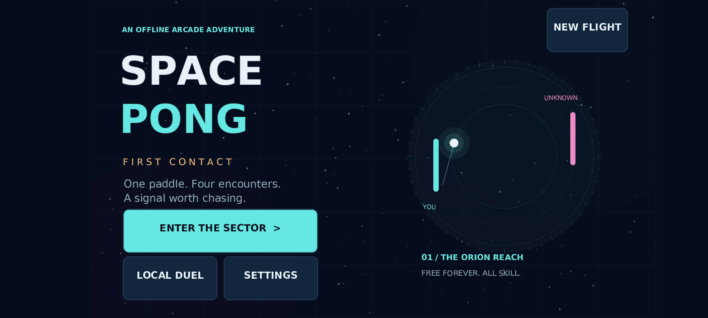

# Space Pong: First Contact

A free, offline Android pong adventure written in Kotlin and libGDX. Three duels teach you to return the ball through asteroid and gravity hazards before a three-phase boss fight. Earn permanent upgrades by improving your medals, or play a friend on the same screen with equal equipment.

**No ads. No purchases. No paid advantages. No accounts or network permission.**



[Android gameplay](docs/screenshots/phone-game.png) | [Tablet chapter map](docs/screenshots/tablet-map.png)

## Play

- Drag vertically on the left to move your paddle. Contact position and paddle movement shape your return.
- Tap **Pulse** just before contact: it arms for 0.6 seconds, boosts the return, and recharges in six seconds.
- Win regular encounters by scoring five goals. Defeat the Warden's six hull before losing your three hull.
- Earn up to three medals per encounter. Only improvements award credits. All upgrades together cost nine of the chapter's twelve available credits; respec is free.
- **Local versus:** two players use their own half and Pulse button. First to seven wins. Campaign upgrades and hazards are disabled.
- Desktop runner: W/S + left Shift for player one; arrows + right Shift for player two. Escape pauses; Tab/Enter navigate menus.

Progress and settings stay on the device. A paused match resumes with a countdown; a match interrupted by process death restarts without losing completed campaign progress.

## Build

Required: JDK 21, Android SDK platform 37, build tools 36.0.0, and Python 3 for packaging verification. The Gradle wrapper verifies its distribution checksum. No system Gradle installation is needed.

Windows PowerShell, from the repository root:

```powershell
$env:JAVA_HOME = 'C:\path\to\jdk-21'
$env:ANDROID_HOME = 'C:\path\to\Android\Sdk'
.\gradlew.bat check :android:assembleDebug :android:bundleRelease
.\gradlew.bat :desktop:run
```

Reopen terminals after permanently changing environment variables. Keep machine paths in environment variables or ignored `local.properties`.

Linux/macOS:

```sh
chmod +x gradlew
./gradlew check :android:assembleDebug :android:bundleRelease
./gradlew :desktop:run
```

Linux CI installs an isolated SDK from the checked-in archive lock. To install the same build profile into a fresh directory on a Linux filesystem:

```sh
python3 tools/android_sdk.py install --profile build \
  --sdk-root "$HOME/.cache/space-pong/locked-sdk" \
  --cache-dir "$HOME/.cache/space-pong/sdk-archives" --accept-licenses
export ANDROID_HOME="$HOME/.cache/space-pong/locked-sdk"
```

The installer preserves existing nonempty SDK directories. Emulator CI uses the `emulator26` and `emulator35` profiles. See [architecture](docs/architecture.md) for verification and pin updates.
Outputs:

- Installable test build: `android/build/outputs/apk/debug/android-debug.apk`
- Unsigned release bundle: `android/build/outputs/bundle/release/android-release.aab`
- Minified smoke build with the development signing key: `./gradlew :android:assembleSmoke`

Debug and smoke signatures are for testing. Production signing and store publication are deliberately separate from this source delivery.

## Verify

```sh
./gradlew check
./gradlew :android:connectedDebugAndroidTest
python -m unittest discover -s tools/tests
python tools/verify_native_alignment.py android/build/outputs/apk/debug/android-debug.apk
python tools/verify_native_alignment.py android/build/outputs/bundle/release/android-release.aab
```

`check` runs simulation/persistence/input/UI tests, Kotlin compilation, formatting checks and Android lint. Tests cover score-once behavior, swept collisions, Pulse, seeded replay, hazards, boss phases, rewards, save recovery and pointer ownership. The packaging verifier rejects malformed libraries and checks ELF/ZIP alignment rather than treating missing data as success.

CI builds Android artifacts and runs emulator tests on API 26 and 35. Device performance and touch feel require separate hardware validation; emulator results do not establish physical-device latency or sustained thermal performance.

## Structure

- `simulation`: deterministic 120Hz gameplay, AI, campaign model, local saves and input ownership.
- `game`: shared rendering, menus, audio, effects and platform-independent screen flow.
- `android`: app lifecycle, safe insets, audio focus, haptics, display selection and packaging.
- `desktop`: development/playtesting launcher.

See [verified results and remaining checks](docs/verification.md), [architecture](docs/architecture.md), [asset provenance](docs/assets.md), and [PLAN-1](https://baz.co/plans/01a1dee5-a7a2-7e13-b215-0fd241dbec57). This first chapter excludes online multiplayer, advertising, billing and additional campaigns.
